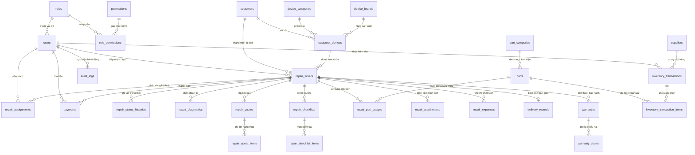

# THIẾT KẾ CƠ SỞ DỮ LIỆU & SƠ ĐỒ ERD (DATABASE DESIGN)
## DỰ ÁN: REPAIRFLOW — HỆ THỐNG QUẢN LÝ TIẾP NHẬN & SỬA CHỮA THIẾT BỊ ĐIỆN TỬ

---

### 1. SƠ ĐỒ THỰC THỂ QUAN HỆ (ENTITY RELATIONSHIP DIAGRAM - ERD)

---

### 2. DANH SÁCH & CẤU TRÚC CHI TIẾT CÁC BẢNG DỮ LIỆU (DATA DICTIONARY)

#### 2.1. Nhóm Người dùng & Phân quyền (Auth & RBAC)

##### Bảng `roles` (Vai trò)
| Cột | Kiểu | Khóa | Null | Mặc định | Diễn giải |
|---|---|:---:|:---:|---|---|
| `id` | INTEGER | PK | NO | AUTO_INCREMENT | Mã định danh vai trò |
| `name` | VARCHAR(50) | UK | NO | | Tên mã vai trò: `admin`, `manager`, `receptionist`, `technician`, `cashier` |
| `display_name` | VARCHAR(100) | | NO | | Tên hiển thị: Quản trị viên, Quản lý, Lễ tân, Kỹ thuật viên, Thu ngân |
| `description` | TEXT | | YES | NULL | Mô tả nhiệm vụ |
| `created_at` | DATETIME | | NO | CURRENT_TIMESTAMP | Thời điểm tạo |

##### Bảng `permissions` (Quyền hạn)
| Cột | Kiểu | Khóa | Null | Mặc định | Diễn giải |
|---|---|:---:|:---:|---|---|
| `id` | INTEGER | PK | NO | AUTO_INCREMENT | Mã định danh quyền |
| `code` | VARCHAR(100) | UK | NO | | Mã quyền: `ticket:create`, `ticket:assign`, `part:issue` |
| `module` | VARCHAR(50) | | NO | | Phân nhóm: `tickets`, `inventory`, `payments`, `users` |
| `description` | VARCHAR(255) | | YES | NULL | Giải thích quyền |

##### Bảng `role_permissions` (Liên kết vai trò - quyền)
| Cột | Kiểu | Khóa | Null | Diễn giải |
|---|---|:---:|:---:|---|
| `role_id` | INTEGER | FK | NO | Tham chiếu `roles.id` (ON DELETE CASCADE) |
| `permission_id` | INTEGER | FK | NO | Tham chiếu `permissions.id` (ON DELETE CASCADE) |
| *Khóa chính:* `(role_id, permission_id)` |

##### Bảng `users` (Tài khoản nhân viên)
| Cột | Kiểu | Khóa | Null | Mặc định | Diễn giải |
|---|---|:---:|:---:|---|---|
| `id` | INTEGER | PK | NO | AUTO_INCREMENT | ID nhân viên |
| `role_id` | INTEGER | FK | NO | | Tham chiếu `roles.id` |
| `username` | VARCHAR(50) | UK | NO | | Tên đăng nhập |
| `email` | VARCHAR(120) | UK | NO | | Địa chỉ email nhân viên |
| `password_hash` | VARCHAR(255) | | NO | | Mật khẩu băm an toàn |
| `full_name` | VARCHAR(100) | | NO | | Họ và tên nhân viên |
| `phone` | VARCHAR(20) | | YES | NULL | Số điện thoại liên hệ |
| `address` | VARCHAR(255) | | YES | NULL | Địa chỉ cư trú |
| `avatar_url` | VARCHAR(255) | | YES | NULL | Ảnh đại diện |
| `is_active` | BOOLEAN | | NO | TRUE | Trạng thái hoạt động |
| `last_login_at` | DATETIME | | YES | NULL | Thời điểm đăng nhập gần nhất |
| `created_at` | DATETIME | | NO | CURRENT_TIMESTAMP | Ngày tạo tài khoản |
| `updated_at` | DATETIME | | NO | CURRENT_TIMESTAMP | Ngày cập nhật |
| `deleted_at` | DATETIME | | YES | NULL | Soft delete |

---

#### 2.2. Nhóm Khách hàng & Thiết bị (Customer & Device)

##### Bảng `customers` (Hồ sơ khách hàng)
| Cột | Kiểu | Khóa | Null | Mặc định | Diễn giải |
|---|---|:---:|:---:|---|---|
| `id` | INTEGER | PK | NO | AUTO_INCREMENT | ID khách hàng |
| `code` | VARCHAR(30) | UK | NO | | Mã khách hàng: `KH-XXXXXX` |
| `name` | VARCHAR(150) | | NO | | Tên khách hàng hoặc tên công ty |
| `phone` | VARCHAR(20) | IDX | NO | | Số điện thoại chính liên hệ |
| `email` | VARCHAR(120) | | YES | NULL | Email |
| `address` | VARCHAR(255) | | YES | NULL | Địa chỉ giao nhận |
| `customer_type` | VARCHAR(20) | | NO | 'individual' | `individual` (Cá nhân) hoặc `company` (Doanh nghiệp) |
| `tax_number` | VARCHAR(50) | | YES | NULL | Mã số thuế (đối với doanh nghiệp) |
| `current_debt` | BIGINT | | NO | 0 | Tổng công nợ hiện tại (VND) |
| `notes` | TEXT | | YES | NULL | Ghi chú khách quen, yêu cầu đặc biệt |
| `created_at` | DATETIME | | NO | CURRENT_TIMESTAMP | Ngày tạo |
| `updated_at` | DATETIME | | NO | CURRENT_TIMESTAMP | Ngày sửa |

##### Bảng `device_categories` (Loại thiết bị)
| Cột | Kiểu | Khóa | Null | Mặc định | Diễn giải |
|---|---|:---:|:---:|---|---|
| `id` | INTEGER | PK | NO | AUTO_INCREMENT | ID loại máy |
| `code` | VARCHAR(50) | UK | NO | | `laptop`, `pc`, `phone`, `tablet`, `printer`, `monitor`, `other` |
| `name` | VARCHAR(100) | | NO | | Tên tiếng Việt: Laptop, Máy tính để bàn, Điện thoại, Máy in... |
| `is_active` | BOOLEAN | | NO | TRUE | Kích hoạt |

##### Bảng `device_brands` (Hãng sản xuất)
| Cột | Kiểu | Khóa | Null | Mặc định | Diễn giải |
|---|---|:---:|:---:|---|---|
| `id` | INTEGER | PK | NO | AUTO_INCREMENT | ID hãng |
| `name` | VARCHAR(100) | UK | NO | | Apple, Dell, Asus, HP, Lenovo, Samsung, Canon... |
| `logo_url` | VARCHAR(255) | | YES | NULL | Logo hãng |
| `is_active` | BOOLEAN | | NO | TRUE | Kích hoạt |

##### Bảng `customer_devices` (Hồ sơ thiết bị của khách)
| Cột | Kiểu | Khóa | Null | Mặc định | Diễn giải |
|---|---|:---:|:---:|---|---|
| `id` | INTEGER | PK | NO | AUTO_INCREMENT | ID thiết bị |
| `customer_id` | INTEGER | FK | NO | | Khách hàng sở hữu (FK `customers.id`) |
| `category_id` | INTEGER | FK | NO | | Loại thiết bị (FK `device_categories.id`) |
| `brand_id` | INTEGER | FK | NO | | Hãng sản xuất (FK `device_brands.id`) |
| `model_name` | VARCHAR(150) | | NO | | Tên dòng máy: `ThinkPad T14 Gen 2`, `MacBook Pro M1 2020` |
| `serial_number` | VARCHAR(100) | IDX | YES | NULL | Serial Number thiết bị |
| `imei` | VARCHAR(50) | IDX | YES | NULL | Số IMEI (cho điện thoại / tablet có khe SIM) |
| `color` | VARCHAR(50) | | YES | NULL | Màu sắc ngoại quan |
| `notes` | TEXT | | YES | NULL | Ghi chú phần cứng, vết trầy cố định |
| `created_at` | DATETIME | | NO | CURRENT_TIMESTAMP | Ngày tạo |

---

#### 2.3. Nhóm Phiếu Sửa Chữa Cốt Lõi (Repair Tickets & Operations)

##### Bảng `repair_tickets` (Phiếu sửa chữa trung tâm)
| Cột | Kiểu | Khóa | Null | Mặc định | Diễn giải |
|---|---|:---:|:---:|---|---|
| `id` | INTEGER | PK | NO | AUTO_INCREMENT | ID phiếu nội bộ |
| `ticket_code` | VARCHAR(50) | UK | NO | | Mã phiếu duy nhất: `SC-YYYYMMDD-XXXX` |
| `customer_id` | INTEGER | FK | NO | | Khách hàng mang thiết bị (FK `customers.id`) |
| `device_id` | INTEGER | FK | NO | | Thiết bị sửa chữa (FK `customer_devices.id`) |
| `created_by` | INTEGER | FK | NO | | Nhân viên tiếp nhận (FK `users.id`) |
| `status` | VARCHAR(30) | IDX | NO | 'Received' | 11 trạng thái chuẩn (Received, Diagnosing, ...) |
| `priority` | VARCHAR(20) | | NO | 'Normal' | `Low`, `Normal`, `High`, `Urgent` |
| `defect_description` | TEXT | | NO | | Mô tả triệu chứng lỗi từ khách hàng |
| `initial_condition` | TEXT | | YES | NULL | Tình trạng lúc nhận: mở nguồn, sạc, màn hình |
| `cosmetic_condition` | TEXT | | YES | NULL | Ngoại quan: trầy xước, nứt móp vỏ |
| `accessories_included`| TEXT | | YES | NULL | Phụ kiện đi kèm: sạc, cáp, túi, chuột... |
| `device_password_hint`| VARCHAR(255) | | YES | NULL | Mật khẩu máy (được mã hóa/bảo vệ) |
| `estimated_completion`| DATETIME | | YES | NULL | Hẹn ngày dự kiến hoàn thành |
| `subtotal_amount` | BIGINT | | NO | 0 | Tổng tiền dịch vụ & linh kiện (VND) |
| `discount_amount` | BIGINT | | NO | 0 | Giảm giá / chiết khấu (VND) |
| `final_amount` | BIGINT | | NO | 0 | Tổng tiền khách phải thanh toán (VND) |
| `paid_amount` | BIGINT | | NO | 0 | Số tiền khách đã thanh toán (VND) |
| `debt_amount` | BIGINT | | NO | 0 | Số tiền còn nợ (VND) |
| `is_warranty_claim` | BOOLEAN | | NO | FALSE | Đánh dấu nếu là phiếu sửa chữa bảo hành lại |
| `parent_ticket_id` | INTEGER | FK | YES | NULL | Phiếu gốc nếu là phiếu bảo hành |
| `cancellation_reason` | TEXT | | YES | NULL | Lý do hủy phiếu (nếu bị hủy) |
| `created_at` | DATETIME | | NO | CURRENT_TIMESTAMP | Ngày giờ tiếp nhận |
| `updated_at` | DATETIME | | NO | CURRENT_TIMESTAMP | Ngày giờ cập nhật |

##### Bảng `repair_status_histories` (Lịch sử chuyển trạng thái)
| Cột | Kiểu | Khóa | Null | Diễn giải |
|---|---|:---:|:---:|---|
| `id` | INTEGER | PK | NO | ID lịch sử |
| `ticket_id` | INTEGER | FK | NO | Phiếu sửa chữa (FK `repair_tickets.id`) |
| `from_status` | VARCHAR(30) | | YES | Trạng thái trước |
| `to_status` | VARCHAR(30) | | NO | Trạng thái sau |
| `changed_by` | INTEGER | FK | NO | Nhân viên thực hiện thay đổi (FK `users.id`) |
| `notes` | TEXT | | YES | Ghi chú lý do chuyển trạng thái |
| `created_at` | DATETIME | | NO | Thời điểm chuyển |

##### Bảng `repair_assignments` (Phân công kỹ thuật)
| Cột | Kiểu | Khóa | Null | Diễn giải |
|---|---|:---:|:---:|---|
| `id` | INTEGER | PK | NO | ID phân công |
| `ticket_id` | INTEGER | FK | NO | Phiếu sửa chữa (FK `repair_tickets.id`) |
| `technician_id` | INTEGER | FK | NO | Kỹ thuật viên (FK `users.id`) |
| `is_primary` | BOOLEAN | | NO | Đánh dấu kỹ thuật viên chịu trách nhiệm chính |
| `assigned_by` | INTEGER | FK | NO | Người giao việc (FK `users.id`) |
| `assigned_at` | DATETIME | | NO | Thời điểm giao |
| `completed_at` | DATETIME | | YES | Thời điểm bàn giao hoàn thành |

##### Bảng `repair_diagnostics` (Chẩn đoán kỹ thuật)
| Cột | Kiểu | Khóa | Null | Diễn giải |
|---|---|:---:|:---:|---|
| `id` | INTEGER | PK | NO | ID chẩn đoán |
| `ticket_id` | INTEGER | FK | NO | Phiếu sửa chữa (FK `repair_tickets.id`) |
| `technician_id` | INTEGER | FK | NO | Kỹ thuật viên chẩn đoán (FK `users.id`) |
| `root_cause` | TEXT | | NO | Nguyên nhân gốc rễ gây ra hư hỏng |
| `proposed_solution`| TEXT | | NO | Phương án kỹ thuật xử lý |
| `estimated_cost` | BIGINT | | NO | Chi phí ước tính sơ bộ |
| `estimated_hours` | DECIMAL(5,2)| | YES | Số giờ dự kiến thực hiện |
| `notes` | TEXT | | YES | Ghi chú kỹ thuật nội bộ |
| `created_at` | DATETIME | | NO | Thời điểm chẩn đoán |

##### Bảng `repair_quotes` (Báo giá sửa chữa)
| Cột | Kiểu | Khóa | Null | Diễn giải |
|---|---|:---:|:---:|---|
| `id` | INTEGER | PK | NO | ID báo giá |
| `ticket_id` | INTEGER | FK | NO | Phiếu sửa chữa (FK `repair_tickets.id`) |
| `quote_code` | VARCHAR(50) | UK | NO | Mã báo giá: `BG-YYYYMMDD-XXXX` |
| `version` | INTEGER | | NO | Phiên bản báo giá: 1, 2, 3... |
| `subtotal` | BIGINT | | NO | Tổng tiền trước chiết khấu |
| `discount` | BIGINT | | NO | Tiền giảm giá |
| `total_amount` | BIGINT | | NO | Tổng tiền báo khách duyệt |
| `status` | VARCHAR(30) | | NO | `Draft`, `Sent`, `Approved`, `Rejected`, `Expired` |
| `rejection_reason` | TEXT | | YES | Lý do khách từ chối báo giá |
| `confirmed_by` | VARCHAR(50) | | YES | Người xác nhận (`Customer_Online`, `Staff_Phone`) |
| `confirmed_at` | DATETIME | | YES | Thời điểm khách xác nhận |
| `created_by` | INTEGER | FK | NO | Người lập báo giá |
| `created_at` | DATETIME | | NO | Ngày tạo |

##### Bảng `repair_quote_items` (Hạng mục báo giá)
| Cột | Kiểu | Khóa | Null | Diễn giải |
|---|---|:---:|:---:|---|
| `id` | INTEGER | PK | NO | ID dòng báo giá |
| `quote_id` | INTEGER | FK | NO | Thuộc báo giá (FK `repair_quotes.id`) |
| `item_type` | VARCHAR(20) | | NO | `labor` (Tiền công sửa chữa) hoặc `part` (Linh kiện thay thế) |
| `part_id` | INTEGER | FK | YES | Mã linh kiện nếu là part (FK `parts.id`) |
| `name` | VARCHAR(200) | | NO | Tên công việc hoặc tên linh kiện |
| `quantity` | INTEGER | | NO | Số lượng |
| `unit_price` | BIGINT | | NO | Đơn giá |
| `labor_fee` | BIGINT | | NO | Tiền công kèm theo (nếu có) |
| `subtotal` | BIGINT | | NO | Thành tiền của dòng |
| `warranty_months` | INTEGER | | NO | Số tháng bảo hành cam kết cho mục này |

##### Bảng `repair_checklists` (Phiếu kiểm tra chất lượng QC)
| Cột | Kiểu | Khóa | Null | Diễn giải |
|---|---|:---:|:---:|---|
| `id` | INTEGER | PK | NO | ID đợt kiểm tra |
| `ticket_id` | INTEGER | FK | NO | Phiếu sửa chữa (FK `repair_tickets.id`) |
| `checked_by` | INTEGER | FK | NO | Kỹ thuật viên/Quản lý QC (FK `users.id`) |
| `is_passed` | BOOLEAN | | NO | Đạt toàn bộ hay không |
| `notes` | TEXT | | YES | Ghi chú chung về chất lượng |
| `created_at` | DATETIME | | NO | Thời điểm kiểm tra |

##### Bảng `repair_checklist_items` (Chi tiết từng mục QC)
| Cột | Kiểu | Khóa | Null | Diễn giải |
|---|---|:---:|:---:|---|
| `id` | INTEGER | PK | NO | ID mục kiểm tra |
| `checklist_id` | INTEGER | FK | NO | Thuộc phiếu QC (FK `repair_checklists.id`) |
| `item_name` | VARCHAR(150) | | NO | Tên tiêu chí (Nguồn, Màn hình, Bàn phím, Loa...) |
| `status` | VARCHAR(20) | | NO | `Pass` (Đạt), `Fail` (Không đạt), `NA` (Không áp dụng) |
| `note` | VARCHAR(255) | | YES | Ghi chú cụ thể cho mục |

##### Bảng `repair_attachments` (Tệp đính kèm & hình ảnh)
| Cột | Kiểu | Khóa | Null | Diễn giải |
|---|---|:---:|:---:|---|
| `id` | INTEGER | PK | NO | ID tệp |
| `ticket_id` | INTEGER | FK | NO | Phiếu sửa chữa (FK `repair_tickets.id`) |
| `stage` | VARCHAR(30) | | NO | `Intake`, `Diagnostics`, `QC`, `Delivery` |
| `file_name` | VARCHAR(255) | | NO | Tên file gốc |
| `file_path` | VARCHAR(255) | | NO | Đường dẫn lưu trữ / URL |
| `file_type` | VARCHAR(50) | | NO | MIME type (image/jpeg, application/pdf...) |
| `file_size` | INTEGER | | NO | Dung lượng tệp (bytes) |
| `uploaded_by` | INTEGER | FK | NO | Nhân viên tải lên (FK `users.id`) |
| `created_at` | DATETIME | | NO | Thời điểm tải lên |

---

#### 2.4. Nhóm Linh Kiện, Kho & Chi Phí (Inventory & Expenses)

##### Bảng `part_categories` (Danh mục linh kiện)
| Cột | Kiểu | Khóa | Null | Diễn giải |
|---|---|:---:|:---:|---|
| `id` | INTEGER | PK | NO | ID danh mục |
| `name` | VARCHAR(100) | UK | NO | Màn hình, Pin, Bàn phím, RAM, Ổ cứng, IC nguồn, Mainboard... |
| `description` | VARCHAR(255) | | YES | Mô tả |

##### Bảng `parts` (Danh mục vật tư linh kiện)
| Cột | Kiểu | Khóa | Null | Diễn giải |
|---|---|:---:|:---:|---|
| `id` | INTEGER | PK | NO | ID linh kiện |
| `sku` | VARCHAR(50) | UK | NO | Mã vạch / SKU duy nhất: `LK-PIN-DELL-5580` |
| `name` | VARCHAR(200) | | NO | Tên linh kiện |
| `category_id` | INTEGER | FK | NO | Danh mục (FK `part_categories.id`) |
| `compatible_models` | TEXT | | YES | Các dòng máy tương thích |
| `cost_price` | BIGINT | | NO | Giá vốn nhập kho gần nhất (VND) |
| `selling_price` | BIGINT | | NO | Giá bán lẻ niêm yết cho khách (VND) |
| `stock_quantity` | INTEGER | | NO | Số lượng tồn kho hiện tại (mặc định 0) |
| `min_stock_alert` | INTEGER | | NO | Ngưỡng báo động sắp hết hàng (mặc định 3) |
| `location` | VARCHAR(100) | | YES | Vị trí kệ/ngăn trong kho |
| `created_at` | DATETIME | | NO | Ngày tạo |
| `updated_at` | DATETIME | | NO | Ngày sửa |

##### Bảng `suppliers` (Nhà cung cấp)
| Cột | Kiểu | Khóa | Null | Diễn giải |
|---|---|:---:|:---:|---|
| `id` | INTEGER | PK | NO | ID nhà cung cấp |
| `code` | VARCHAR(50) | UK | NO | Mã NCC: `NCC-XXXXXX` |
| `name` | VARCHAR(150) | | NO | Tên công ty / Cửa hàng phân phối |
| `phone` | VARCHAR(20) | | NO | Số điện thoại liên hệ |
| `email` | VARCHAR(120) | | YES | Email |
| `address` | VARCHAR(255) | | YES | Địa chỉ |
| `is_active` | BOOLEAN | | NO | Đang hoạt động |

##### Bảng `inventory_transactions` (Phiếu giao dịch kho)
| Cột | Kiểu | Khóa | Null | Diễn giải |
|---|---|:---:|:---:|---|
| `id` | INTEGER | PK | NO | ID giao dịch |
| `transaction_code` | VARCHAR(50) | UK | NO | Mã phiếu: `PN-YYYYMMDD-XXXX` hoặc `PX-...` |
| `type` | VARCHAR(20) | | NO | `Receipt` (Nhập kho), `Issue` (Xuất kho), `Return` (Hoàn trả) |
| `supplier_id` | INTEGER | FK | YES | Nhà cung cấp (với phiếu nhập) |
| `ticket_id` | INTEGER | FK | YES | Phiếu sửa chữa (với phiếu xuất) |
| `created_by` | INTEGER | FK | NO | Nhân viên lập phiếu (FK `users.id`) |
| `total_value` | BIGINT | | NO | Tổng giá trị phiếu kho (VND) |
| `notes` | TEXT | | YES | Ghi chú lý do nhập/xuất |
| `created_at` | DATETIME | | NO | Thời điểm giao dịch |

##### Bảng `inventory_transaction_items` (Chi tiết phiếu kho)
| Cột | Kiểu | Khóa | Null | Diễn giải |
|---|---|:---:|:---:|---|
| `id` | INTEGER | PK | NO | ID dòng chi tiết |
| `transaction_id` | INTEGER | FK | NO | Phiếu giao dịch (FK `inventory_transactions.id`) |
| `part_id` | INTEGER | FK | NO | Linh kiện (FK `parts.id`) |
| `quantity` | INTEGER | | NO | Số lượng xuất/nhập |
| `unit_price` | BIGINT | | NO | Đơn giá vốn tại thời điểm giao dịch |
| `subtotal` | BIGINT | | NO | Thành tiền dòng |

##### Bảng `repair_part_usages` (Linh kiện gắn vào phiếu sửa chữa)
| Cột | Kiểu | Khóa | Null | Diễn giải |
|---|---|:---:|:---:|---|
| `id` | INTEGER | PK | NO | ID sử dụng |
| `ticket_id` | INTEGER | FK | NO | Phiếu sửa chữa (FK `repair_tickets.id`) |
| `part_id` | INTEGER | FK | NO | Linh kiện (FK `parts.id`) |
| `quantity` | INTEGER | | NO | Số lượng đã dùng |
| `cost_price` | BIGINT | | NO | Giá vốn lúc xuất (VND) để tính lợi nhuận |
| `selling_price` | BIGINT | | NO | Giá bán tính cho khách (VND) |
| `technician_id` | INTEGER | FK | NO | Kỹ thuật viên thao tác (FK `users.id`) |
| `status` | VARCHAR(20) | | NO | `Used` (Đã gắn vào máy), `Returned` (Đã hoàn kho) |
| `created_at` | DATETIME | | NO | Thời điểm ghi nhận |

##### Bảng `repair_expenses` (Chi phí sửa chữa phát sinh)
| Cột | Kiểu | Khóa | Null | Diễn giải |
|---|---|:---:|:---:|---|
| `id` | INTEGER | PK | NO | ID chi phí |
| `ticket_id` | INTEGER | FK | NO | Phiếu sửa chữa (FK `repair_tickets.id`) |
| `title` | VARCHAR(150) | | NO | Tên chi phí: Thuê đóng chip VGA ngoài, Phí ship hỏa tốc... |
| `amount` | BIGINT | | NO | Số tiền chi thực tế (VND) |
| `category` | VARCHAR(50) | | NO | `Outsource`, `Shipping`, `Consumable`, `Other` |
| `paid_to` | VARCHAR(150) | | YES | Người nhận tiền chi |
| `notes` | TEXT | | YES | Ghi chú |
| `created_by` | INTEGER | FK | NO | Người tạo |
| `created_at` | DATETIME | | NO | Ngày chi |

---

#### 2.5. Nhóm Thanh Toán, Bàn Giao & Bảo Hành (Payments, Delivery, Warranty)

##### Bảng `payments` (Lịch sử thanh toán thu tiền)
| Cột | Kiểu | Khóa | Null | Diễn giải |
|---|---|:---:|:---:|---|
| `id` | INTEGER | PK | NO | ID thanh toán |
| `payment_code` | VARCHAR(50) | UK | NO | Mã phiếu thu: `PT-YYYYMMDD-XXXX` |
| `ticket_id` | INTEGER | FK | NO | Phiếu sửa chữa (FK `repair_tickets.id`) |
| `amount` | BIGINT | | NO | Số tiền thu đợt này (VND) |
| `payment_method` | VARCHAR(30) | | NO | `Cash` (Tiền mặt), `Bank_Transfer` (Chuyển khoản), `POS_Card` |
| `payment_type` | VARCHAR(30) | | NO | `Deposit` (Đặt cọc), `Installment` (Từng đợt), `Final` (Dứt điểm) |
| `transaction_ref` | VARCHAR(100) | | YES | Mã tham chiếu ngân hàng (nếu CK) |
| `cashier_id` | INTEGER | FK | NO | Thu ngân nhận tiền (FK `users.id`) |
| `notes` | TEXT | | YES | Ghi chú thanh toán |
| `created_at` | DATETIME | | NO | Ngày giờ thu tiền |

##### Bảng `delivery_records` (Biên bản bàn giao thiết bị)
| Cột | Kiểu | Khóa | Null | Diễn giải |
|---|---|:---:|:---:|---|
| `id` | INTEGER | PK | NO | ID biên bản bàn giao |
| `ticket_id` | INTEGER | FK | NO | Phiếu sửa chữa (FK `repair_tickets.id` - 1:1) |
| `receiver_name` | VARCHAR(100) | | NO | Họ tên người đến nhận máy |
| `receiver_phone` | VARCHAR(20) | | NO | Số điện thoại người nhận máy |
| `delivered_by` | INTEGER | FK | NO | Nhân viên bàn giao (FK `users.id`) |
| `accessories_returned` | TEXT | | NO | Xác nhận đã hoàn trả đầy đủ phụ kiện |
| `customer_feedback` | TEXT | | YES | Đánh giá của khách hàng |
| `signature_confirmed` | BOOLEAN | | NO | Đã ký nhận bàn giao |
| `delivered_at` | DATETIME | | NO | Thời điểm bàn giao máy thực tế |

##### Bảng `warranties` (Sổ theo dõi bảo hành)
| Cột | Kiểu | Khóa | Null | Diễn giải |
|---|---|:---:|:---:|---|
| `id` | INTEGER | PK | NO | ID bảo hành |
| `warranty_code` | VARCHAR(50) | UK | NO | Mã bảo hành: `BH-YYYYMMDD-XXXX` |
| `ticket_id` | INTEGER | FK | NO | Phiếu sửa chữa gốc (FK `repair_tickets.id`) |
| `start_date` | DATE | | NO | Ngày bắt đầu bảo hành |
| `end_date` | DATE | IDX | NO | Ngày hết hạn bảo hành |
| `terms` | TEXT | | YES | Điều khoản bảo hành chi tiết |
| `status` | VARCHAR(20) | | NO | `Active` (Còn hạn), `Expired` (Hết hạn), `Voided` (Hủy do vi phạm) |
| `created_at` | DATETIME | | NO | Ngày kích hoạt |

##### Bảng `warranty_claims` (Phiếu khiếu nại bảo hành)
| Cột | Kiểu | Khóa | Null | Diễn giải |
|---|---|:---:|:---:|---|
| `id` | INTEGER | PK | NO | ID khiếu nại |
| `warranty_id` | INTEGER | FK | NO | Gói bảo hành (FK `warranties.id`) |
| `claim_ticket_id` | INTEGER | FK | NO | Phiếu tiếp nhận xử lý mới (FK `repair_tickets.id`) |
| `defect_reported` | TEXT | | NO | Lỗi phát sinh lại |
| `is_covered` | BOOLEAN | | NO | Có đủ điều kiện bảo hành miễn phí hay không |
| `created_at` | DATETIME | | NO | Ngày tiếp nhận khiếu nại |

---

#### 2.6. Nhóm Hệ Thống & Kiểm Toán (Settings & Audit Logs)

##### Bảng `store_settings` (Cấu hình cửa hàng & mẫu in)
| Cột | Kiểu | Khóa | Null | Diễn giải |
|---|---|:---:|:---:|---|
| `id` | INTEGER | PK | NO | ID (duy nhất 1 bản ghi cấu hình) |
| `store_name` | VARCHAR(150) | | NO | Tên cửa hàng |
| `store_slogan` | VARCHAR(255) | | YES | Khẩu hiệu / Slogan |
| `phone` | VARCHAR(50) | | NO | Hotline liên hệ |
| `email` | VARCHAR(100) | | YES | Email cửa hàng |
| `address` | VARCHAR(255) | | NO | Địa chỉ cửa hàng |
| `tax_number` | VARCHAR(50) | | YES | Mã số thuế |
| `bank_name` | VARCHAR(100) | | YES | Tên ngân hàng nhận CK (VD: MB Bank, Vietcombank) |
| `bank_account_no` | VARCHAR(50) | | YES | Số tài khoản ngân hàng |
| `bank_account_name`| VARCHAR(100) | | YES | Tên chủ tài khoản |
| `ticket_prefix` | VARCHAR(10) | | NO | Tiền tố mã phiếu sửa chữa (mặc định: `SC`) |
| `default_warranty_days`| INTEGER | | NO | Thời hạn bảo hành mặc định (mặc định: 90 ngày) |
| `terms_intake` | TEXT | | YES | Điều khoản in trên phiếu tiếp nhận |
| `terms_warranty` | TEXT | | YES | Điều khoản in trên phiếu bảo hành |
| `updated_at` | DATETIME | | NO | Ngày cập nhật |

##### Bảng `audit_logs` (Nhật ký kiểm toán hệ thống)
| Cột | Kiểu | Khóa | Null | Diễn giải |
|---|---|:---:|:---:|---|
| `id` | INTEGER | PK | NO | ID log |
| `user_id` | INTEGER | FK | YES | Người thực hiện (FK `users.id`, null nếu hệ thống) |
| `action` | VARCHAR(50) | IDX | NO | `CREATE_TICKET`, `CHANGE_STATUS`, `APPROVE_QUOTE`, `ISSUE_PART`, `PAYMENT`... |
| `entity_type` | VARCHAR(50) | | NO | `repair_tickets`, `payments`, `inventory`, `users` |
| `entity_id` | VARCHAR(50) | | NO | ID đối tượng bị tác động |
| `old_values` | TEXT | | YES | Dữ liệu JSON trước khi thay đổi |
| `new_values` | TEXT | | YES | Dữ liệu JSON sau khi thay đổi |
| `ip_address` | VARCHAR(45) | | YES | Địa chỉ IP máy khách |
| `user_agent` | VARCHAR(255) | | YES | Trình duyệt người dùng |
| `created_at` | DATETIME | IDX | NO | Thời điểm thực hiện hành động |

---

### 3. QUY HOẠCH CHỈ MỤC & TOÀN VẸN DỮ LIỆU (INDEXES & CONSTRAINTS)

1. **Unique Indexes:**
   - `users.username`, `users.email`
   - `customers.code`
   - `repair_tickets.ticket_code`
   - `parts.sku`
   - `inventory_transactions.transaction_code`
   - `repair_quotes.quote_code`
   - `payments.payment_code`
   - `warranties.warranty_code`

2. **Performance Indexes (Tìm kiếm nhanh & Lọc báo cáo):**
   - `customers.phone` (Tra cứu tức thì khi khách gọi đến hoặc tới quầy)
   - `customer_devices.serial_number`, `customer_devices.imei`
   - `repair_tickets.status`, `repair_tickets.created_at`, `repair_tickets.customer_id`
   - `warranties.end_date` (Cảnh báo và lọc phiếu sắp hết hạn bảo hành)
   - `audit_logs.action`, `audit_logs.created_at`

3. **Transaction Boundaries (Giao dịch ACID):**
   - **Tạo phiếu tiếp nhận:** Insert Khách hàng (nếu mới) + Insert Thiết bị (nếu mới) + Insert Ticket + Insert Status History = 1 Transaction.
   - **Xuất kho linh kiện:** Update trừ tồn kho `parts.stock_quantity` + Insert `repair_part_usages` + Insert `inventory_transactions` + Insert `inventory_transaction_items` = 1 Transaction có kiểm tra `stock_quantity >= quantity_requested`.
   - **Ghi nhận thanh toán:** Insert `payments` + Update `repair_tickets.paid_amount` + Update `repair_tickets.debt_amount` + Update `customers.current_debt` = 1 Transaction.
